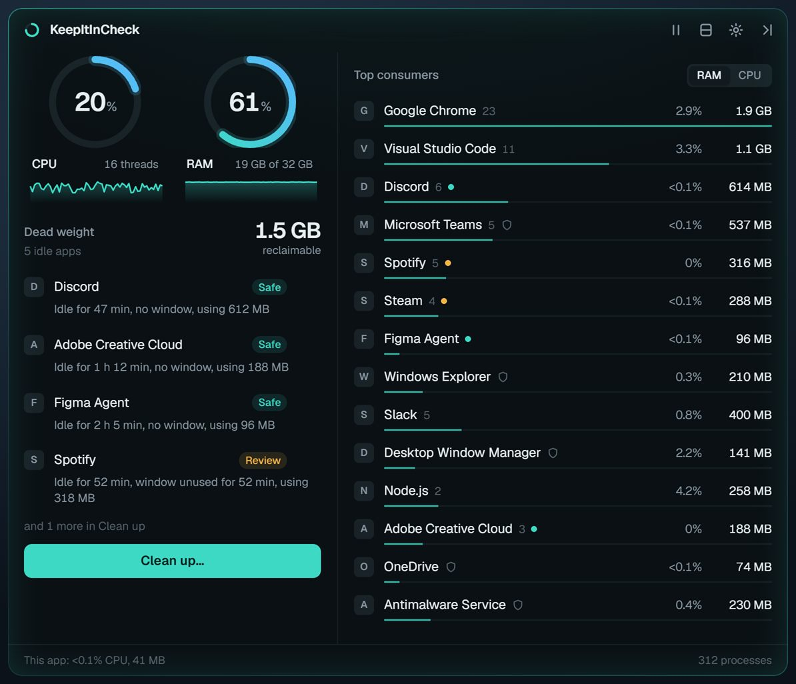

# KeepItInCheck

[](https://github.com/MiloshMilinkov/KeepItInCheck/actions/workflows/ci.yml)

> **⚠️ View only — not open source.**
> This code is public for viewing only. Copying, modifying, deploying, redistributing or reusing any part of it (code, design, texts or branding), or using it to train AI models, is not allowed without written permission. See [LICENSE](LICENSE).

A tiny edge-docked Windows panel that shows which apps are eating your RAM and CPU, spots the
ones that are running but adding nothing, and closes them safely, only after you confirm.



- **Live view.** CPU and RAM ring gauges with 60-second sparklines, and a Top consumers list
  that rolls Chrome, Edge, Discord and other multi-process apps up into one row.
- **Dead weight detector.** Flags idle apps as *Safe to close* or *Probably safe*, each with a
  plain-English reason ("Idle for 47 min, no window, using 312 MB") and a *Reclaimable* total.
  See [docs/dead-weight-score.md](docs/dead-weight-score.md).
- **Safe cleanup.** Preview sheet with checkboxes, graceful close first, a 5 s grace period, and
  force-kill only for windowless background processes. Results show the RAM actually freed, a
  log, and Relaunch. Dry-run mode and a never-touch list are included.
- **Hard safety rules.** Core Windows processes, services, session-0 processes, security
  software, Microsoft-signed binaries (Authenticode), the app itself and the parents of your
  active window are never suggested or closed.
- **Stays out of the way.** Docks to any edge of any monitor and auto-hides to a thin glowing
  strip. Ctrl+Alt+R toggles it, and there's a tray menu.
- **Startup apps.** See everything that starts with Windows (Run keys and Startup folders) and
  switch entries off with a confirmation. It uses the same reversible switch as Task Manager;
  nothing is deleted. All-users entries need admin and are shown read-only.
- **Weekly report.** Top offenders over the last 7 days by RAM held while idle, memory
  (GB·h) and CPU time, a per-day RAM chart, and what your cleanups returned.
- **Local only.** No network calls, no telemetry. CPU and RAM only, no GPU tracking.

## Requirements

- Windows 10 or 11 (x64). WebView2 is preinstalled on Windows 11; the installer bootstraps it on
  Windows 10 if missing.
- To build: Node.js 20+ and npm, Rust (stable, `x86_64-pc-windows-msvc`), and Visual Studio
  Build Tools with the "Desktop development with C++" workload.

```bash
winget install Rustlang.Rustup
```

```bash
winget install Microsoft.VisualStudio.2022.BuildTools --override "--wait --passive --add Microsoft.VisualStudio.Workload.VCTools --includeRecommended"
```

## Setup and development

```bash
npm install
```

```bash
npm run app:dev
```

`app:dev` starts Vite on port 1420 and the Tauri shell with hot reload. To work on the UI alone,
`npm run dev` and open http://localhost:1420: outside Tauri the app runs on built-in mock data.

Debug aid: set `KIC_DUMP` to a file path and every snapshot is written there as JSON.

## Tests

```bash
npm run test:rust
```

```bash
npm test
```

```bash
npm run typecheck
```

The Rust suite covers the classifier (protected / safe / probable / keep cases and the reason
text), grouping, the rolling history, dock geometry, settings and a live Authenticode check.

## Build and package

```bash
npm run app:build
```

This produces, under `src-tauri/target/release/bundle/`:

- `nsis/KeepItInCheck_<version>_x64-setup.exe`: per-user installer, no admin rights needed
- `msi/KeepItInCheck_<version>_x64_en-US.msi`: MSI for managed installs

`npx tauri build --no-bundle` builds just `src-tauri/target/release/keepitincheck.exe`.
The first bundle build downloads the WiX and NSIS toolsets once (build time only; the app
itself never uses the network). Installers are unsigned. Sign them with your own certificate
(`bundle.windows.certificateThumbprint` in `tauri.conf.json`) to avoid SmartScreen prompts.

## Architecture

```
src-tauri/                 Rust back-end (Tauri 2)
  src/sampler.rs           one background thread: tick -> group -> history -> classify -> emit
  src/grouping.rs          processes -> applications (parent chain, helpers, install folder)
  src/history.rs           15 s checkpoints of cumulative CPU / I/O, focus and audio per app
  src/classifier.rs        dead-weight score and Safe / Probable / Keep verdicts (unit tests)
  src/protect.rs           protected, security, cautious and helper process lists
  src/cleanup.rs           graceful close -> 5 s -> background-only kill, log, relaunch
  src/report.rs            per-day usage store and the weekly "top offenders" report
  src/dock.rs              per-monitor, DPI-aware edge geometry (unit tests)
  src/shell.rs             tray, global hotkey, drag-to-snap, Acrylic backdrop, autostart
  src/commands.rs          IPC surface used by the UI
  src/platform/            OS abstraction (trait Platform)
    windows/               NtQuerySystemInformation process table, EnumWindows, WASAPI audio,
                           service PIDs, version info, Authenticode, shell icons, startup apps
    other.rs               stub back-end for macOS / Linux (falls back to sysinfo)
src/                       React + TypeScript + Tailwind + Framer Motion UI
  components/              Gauge, Sparkline, AppList, DeadWeight, CleanupSheet, SettingsSheet,
                           TitleBar, EdgeStrip, StartupSheet, ReportSheet
  hooks/                   useSnapshot, useSettings, useTicker, useIcon
  lib/                     typed IPC wrapper, formatting, browser mock
docs/dead-weight-score.md  how the score works and how to tune it
```

### Keeping the monitor tiny

- **One syscall per tick.** On Windows the process table comes from a single
  `NtQuerySystemInformation(SystemProcessInformation)` call (PID, parent, session, CPU times,
  private working set and I/O counters for every process). `sysinfo` provides system-wide CPU and
  RAM and is the cross-platform fallback for the process table.
- **Adaptive polling.** 1 s while the panel is open, 5 s while collapsed, nothing while paused.
  While collapsed the sampler only updates history (no classification or UI payload), the
  edge strip is told only when high load starts or ends, and WebView2 drops to its low-memory mode.
- **Cheap history.** Averages come from cumulative counters checkpointed every 15 s, about 40
  small records per app.
- **Slow work off the hot path.** Exe paths and version info are cached per process, and
  Authenticode checks run once per exe on a background-priority thread.
- **UI.** Number tickers write to the DOM directly (no React renders), list rows re-render only
  when a visible value changes, bars animate with `transform` only, and gauge arcs ease with CSS
  transitions.

## Settings and data

Stored in `%APPDATA%\com.milinkov.keepitincheck\`:

- `settings.json`: refresh rates, dock edge and monitor, thresholds, never-touch list, snoozes,
  theme, hotkey
- `cleanup-log.json`: last 200 cleanup results
- `usage.json`: per-day, per-app usage totals for the weekly report (kept for 8 days)

## License

Copyright © 2026 Miloš Milinkov. All rights reserved.

This project is proprietary and **not** open source. No licence is granted to use, copy, modify, deploy or distribute it. See [LICENSE](LICENSE) for the full terms. For permission requests, contact milos300399@gmail.com.

Security issues: see [SECURITY.md](SECURITY.md).
